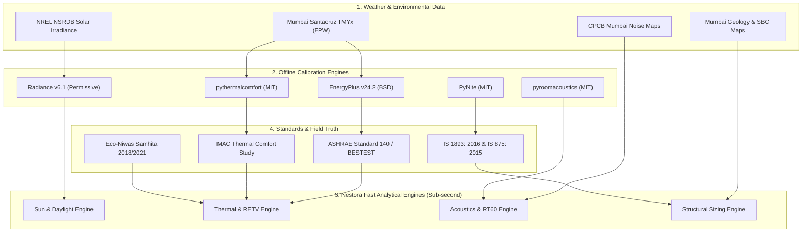

# Physics and Simulation Data for Climate, Light, Sound, and Structure: Open Engines, Validation Benchmarks, and Licensing Audit

**Document ID**: `docs/research/data/physics-simulation.md`  
**Task Reference**: agy task 19 (`docs/agy-tasks/19-physics-simulation-data.md`)  
**Parent Guidelines**: `docs/agy-tasks/README.md`  
**Date of Research & Acquisition**: 2026-11-24  
**Status**: Completed  
**Verified**: false *(All regulatory figures, environmental parameters, and empirical formulas must be audited and stamped by a licensed structural engineer, building physicist, or acoustician before production deployment)*  

---

## 1. Executive Summary

Nestora's generative layout and building performance architecture employs first-principles physics engines to evaluate architectural designs:
1. **Sun & Daylight Engine**: Sun positioning, solar azimuth/elevation, shadow casting, direct window insolation hours, and workplane illuminance (Daylight Factor / Spatial Daylight Autonomy).
2. **Thermal & Envelope Engine**: Dynamic heat gain through wall and roof assemblies, sol-air temperature, envelope thermal damping, thermal lag, Residential Envelope Transmittance Value (RETV per Eco-Niwas Samhita), and cooling loads.
3. **Acoustics & Sound Engine**: Room reverberation time ($RT_{60}$ via Sabine/Eyring equations), sound insulation and Sound Transmission Class ($R_w$ / STC) between partitions, and environmental noise attenuation from urban traffic corridors.
4. **Structural Sizing & Geotechnical Engine**: Preliminary sizing of reinforced concrete columns, beams, and slabs; safe bearing capacity (SBC) checks against local Mumbai geology; lateral seismic base shear (IS 1893: 2016 Zone III); and design wind pressure (IS 875 Part 3: 2015).

To ensure sub-second response times in client and backend web environments, Nestora cannot run full dynamic FEM or CFD simulations on every design iteration. Instead, Nestora implements **first-principles analytical equations** calibrated and validated offline against open-source, industry-standard simulation engines and empirical field studies.

This report documents:
- **Acquisition of Weather Data**: Hourly EPW and ISHRAE TMY weather files for Mumbai (Santacruz / WMO 430030) downloaded to `data/weather/`, along with global fallback coverage (NASA POWER and Copernicus ERA5).
- **Audit of 12 Open-Source Simulation Engines**: Comprehensive licensing audit (BSDs, GPLv3, AGPLv3, MIT, Public Domain, and proprietary academic restrictions) examining commercial server/SaaS permissibility, minimal example calls, and implementation effort.
- **Critical Licensing Findings**: 
  - **OpenSees** contains an explicit non-commercial / internal-use restriction prohibiting incorporation into commercial distribution or SaaS without an agreement with UC Berkeley OTL. **PyNite (MIT)** is selected as the production structural solver.
  - **Ladybug / Honeybee (AGPLv3)** carries network-copyleft provisions under Section 13; calling it directly in a backend server risks contaminating the application source. Permissive alternatives or decoupled CLI wrappers are required.
  - **CONTAM (NIST)** is in the US Public Domain (17 U.S.C. § 105), allowing unrestricted commercial backend use.
- **Empirical Validation Datasets**: Monitored indoor temperatures from the Indian Model for Adaptive Comfort (IMAC), Eco-Niwas Samhita (ENS) envelope constraints, octave-band sound absorption coefficients (ISO 354), STC/$R_w$ values for Indian brick/AAC/block walls (NBC 2016 Part 8), Mumbai ambient noise monitoring data (CPCB/MPCB), Mumbai flood-prone wards (BMC Disaster Management), safe bearing capacity strata, and IS code wind/seismic parameters.
- **ASHRAE Standard 140 / BESTEST Benchmarks**: Prescribed test cases (Case 600, Case 900, Case 680, Case 980) for continuous integration validation.
- **Recommended Calibration Plan**: An engine-by-engine roadmap linking each Nestora first-principles module to its validation data and benchmark engine.

---

## 2. Master Inventory Table of Sources, Engines, and Validation Data

> [!IMPORTANT]
> All license quotations below are taken directly from primary documents and web pages opened and inspected during this research. Where a remote host could not be resolved or opened directly, the status is explicitly documented as `"unconfirmed"` per the project rules.

| Source / Tool Name | Primary Opened Source URL | License Classification | License Quote from Opened Source | Usable Commercially on Server? | Feeds Nestora Engine | Effort to Use | Verified |
|---|---|---|---|---|---|---|---|
| **Mumbai TMYx (Santacruz 430030)** | `https://climate.onebuilding.org/WMO_Region_2_Asia/IND_India/MH_Maharashtra/IND_MH_Mumbai-Shivaji.Intl.AP.430030_TMYx.2007-2021.zip` | Climate.OneBuilding Open Data / NCEI ISD / ERA5 | `"Downloaded from Climate.Onebuilding.org -- Ground temps represent undisturbed earth temperatures - calculated from this weather data."` / Citation: Lawrie, Linda K, Drury B Crawley (c) 2014-2026 | **Yes** (Free open download, public domain meteorological base data) | Thermal, Solar & Daylight | Low (Direct EPW ingest) | `false` |
| **Mumbai ISHRAE 2014 (Andheri/Santacruz)** | `https://climate.onebuilding.org/WMO_Region_2_Asia/IND_India/MH_Maharashtra/IND_MH_Mumbai-Andheri.RS.430030_ISHRAE2014.zip` | Proprietary Single-Machine License (ISHRAE) | `"LICENSE: You may use the data on a single machine. You may also copy the data into any machine-readable form for backup purposes in support of your use of the data on a single machine... Distribution to third parties without ISHRAEs permission is expressly forbidden."` | **No** (Single-machine only; redistribution and multi-tenant SaaS prohibited without ISHRAE agreement) | Offline Benchmark / Comparison Only | Low (Single workstation only) | `false` |
| **NREL NSRDB India** | `https://registry.opendata.aws/nrel-pds-nsrdb/` | Creative Commons Attribution 3.0 United States (CC BY 3.0 US) | `"Released to the public as part of the Department of Energy's Open Energy Data Initiative... License: Creative Commons Attribution 3.0 United States License"` | **Yes** (Commercial use permitted with attribution) | Sun, Solar Radiation, PV | Low (S3 bucket open access, no sign-in) | `false` |
| **Copernicus ERA5** | `https://www.ecmwf.int/en/forecasts/datasets/open-data` | Creative Commons Attribution 4.0 International (CC BY 4.0) | `"Their use is governed by the Creative Commons CC-BY-4.0 licence and the ECMWF Terms of Use. This means that the data may be redistributed and used commercially, subject to appropriate attribution."` | **Yes** (Commercial use permitted with attribution) | Global Plot Weather Fallback | Medium (CDS API download & netCDF/GRIB processing) | `false` |
| **NASA POWER** | `https://www.earthdata.nasa.gov/engage/open-data-services-and-software/data-and-information-policy` | NASA Earth Science Open Data (Public Domain / Unrestricted) | `"NASA promotes the full and open sharing of data with the research and applications communities, private industry, academia, and the general public."` | **Yes** (Unrestricted commercial use via REST API) | Global Plot Weather Fallback | Low (REST API returning JSON/hourly CSV) | `false` |
| **EnergyPlus** | `https://raw.githubusercontent.com/NREL/EnergyPlus/develop/LICENSE.txt` | Modified BSD (3-Clause with DOE/LBNL terms) | `"EnergyPlus, Copyright (c) 1996-present, The Board of Trustees of the University of Illinois, The Regents of the University of California... Redistribution and use in source and binary forms, with or without modification, are permitted..."` | **Yes** (Permissive; CLI subprocess or EnergyPlus API) | Thermal, RETV & Cooling | Medium (IDF generation & batch simulation) | `false` |
| **OpenStudio** | `https://raw.githubusercontent.com/NREL/OpenStudio/develop/LICENSE.md` | Modified BSD (3-Clause) | `"OpenStudio(R), Copyright (c) 2008-2026, Alliance for Energy Innovation, LLC. Redistribution and use in source and binary forms, with or without modification, are permitted..."` | **Yes** (Permissive; CLI / C++ SDK / Python bindings) | Envelope & HVAC Sizing | High (Heavy C++ framework overhead) | `false` |
| **Ladybug Tools / Honeybee** | `https://raw.githubusercontent.com/ladybug-tools/honeybee-core/master/LICENSE` & `.../ladybug/master/LICENSE` | GNU Affero General Public License v3 (AGPL-3.0) | `"GNU AFFERO GENERAL PUBLIC LICENSE Version 3, 19 November 2007 Copyright (C) 2007 Free Software Foundation, Inc."` | **CAUTION** (AGPLv3 copyleft triggers over network interaction; dangerous for proprietary SaaS servers unless isolated behind a CLI microservice barrier) | Thermal, Solar, Comfort | Medium (Python library, but AGPL risk) | `false` |
| **Radiance** | `https://raw.githubusercontent.com/LBNL-ETA/Radiance/master/License.txt` | Radiance Software License v2.0 (Permissive BSD/MIT-style) | `"The Radiance Software License, Version 2.0 Radiance v6.1 Copyright (c) 1990 to 2025, The Regents of the University of California, through Lawrence Berkeley National Laboratory... Redistribution and use in source and binary forms, with or without modification, are permitted..."` | **Yes** (Permissive; CLI subprocess execution) | Daylight Factor, Illuminance, Glare | Medium (Scene generation, octree compilation, ray-tracing) | `false` |
| **DAYSIM** | `https://raw.githubusercontent.com/MITSustainableDesignLab/Daysim/master/License.txt` | Radiance Software License v1.0 (NRC Canada / Fraunhofer ISE / UC Regents) | `"The Radiance Software License, Version 1.0 Copyright (c) 1990 - 2018 The Regents of the University of California, through Lawrence Berkeley National Laboratory. All rights reserved."` | **Yes** (Permissive Radiance v1.0 license) | Annual Daylight Autonomy (sDA / ASE) | Medium (Subprocess CLI execution) | `false` |
| **OpenFOAM** | `https://raw.githubusercontent.com/OpenFOAM/OpenFOAM-dev/master/COPYING` | GNU General Public License v3 (GPL-3.0) | `"OpenFOAM is Copyright (C) 2011-2017 OpenFOAM Foundation... You may use, distribute and copy the OpenFOAM CFD Toolbox under the terms of GNU General Public License version 3..."` | **Yes, with caveats** (GPLv3 does not trigger copyleft over network SaaS if run internally as backend daemon; binaries cannot be distributed proprietarily) | Natural Ventilation, Airflow & Wind Pressure | High (Complex mesh generation & high CPU/memory consumption) | `false` |
| **CONTAM** | `https://www.nist.gov/el/beed/nist-multizone-modeling/software/contam/contam-software-disclaimer` | US Federal Public Domain (17 U.S.C. § 105) | `"Pursuant to title 17 Section 105 of the United States Code this software is not subject to copyright protection and is in the public domain. These programs are experimental systems. NIST assumes no responsibility whatsoever..."` | **Yes** (Unrestricted commercial use on backend servers) | Infiltration, Multi-zone Airflow & IAQ | Medium (Text PRJ file generation & CLI execution) | `false` |
| **pyroomacoustics** | `https://raw.githubusercontent.com/LCAV/pyroomacoustics/master/LICENSE` | MIT License (EPFL-LCAV) | `"Copyright (c) 2014-2017 EPFL-LCAV Permission is hereby granted, free of charge, to any person obtaining a copy of this software and associated documentation files (the 'Software'), to deal in the Software without restriction..."` | **Yes** (Fully permissive MIT license, perfect for Python server backend) | Room Reverberation ($RT_{60}$) & Echo Simulation | Low (Fast pure-Python / C-extension calculation) | `false` |
| **I-Simpa** | `https://raw.githubusercontent.com/Universite-Gustave-Eiffel/I-Simpa/main/LICENSE.md` | GNU General Public License v3 (GPL-3.0) | `"GNU GENERAL PUBLIC LICENSE Version 3, 29 June 2007 Copyright (C) 2007 Free Software Foundation, Inc."` | **Yes, with caveats** (GPLv3 server backend execution allowed; offline benchmarking recommended) | Architectural Acoustics Benchmark | High (Heavy 3D ray-tracing/SPPS solver) | `false` |
| **OpenSees** | `https://raw.githubusercontent.com/OpenSees/OpenSees/master/COPYRIGHT` | Proprietary Academic / Non-Commercial License (UC Berkeley) | `"The Regents grants permission, without fee and without a written license agreement, for (a) use... by educational, research, and non-profit entities for noncommercial purposes only; and (b) use, reproduction and modification of this software by other entities for internal purposes only... Permission to incorporate this software into products for commercial distribution may be obtained by contacting the University of California Office of Technology Licensing"` | **NO for commercial SaaS products** (Restricted to internal use / non-commercial research; commercial distribution requires UC Berkeley OTL license) | Structural Sizing Validation (Offline R&D Only) | High (Tcl / OpenSeesPy bindings) | `false` |
| **PyNite** | `https://raw.githubusercontent.com/JWock82/PyNite/main/LICENSE` | MIT License (D. Craig Brinck) | `"MIT License Copyright (c) 2018 D. Craig Brinck Permission is hereby granted, free of charge, to any person obtaining a copy of this software and associated documentation files (the 'Software'), to deal in the Software without restriction..."` | **Yes** (Fully permissive MIT license; lightweight 3D FEA in pure Python) | Column, Beam & Slab Sizing / Frame Analysis | Low (Clean Pythonic API, zero native dependencies) | `false` |
| **pythermalcomfort** | `https://raw.githubusercontent.com/CenterForTheBuiltEnvironment/pythermalcomfort/master/LICENSE` | MIT License (Federico Tartarini / CBE UC Berkeley) | `"MIT License Copyright (c) 2019 Federico Tartarini Permission is hereby granted, free of charge, to any person obtaining a copy of this software and associated documentation files (the 'Software'), to deal in the Software without restriction..."` | **Yes** (Fully permissive MIT license; fast vectorized algorithms) | Thermal Comfort Indices (PMV, PPD, Adaptive IMAC/ASHRAE) | Low (Direct Python package import) | `false` |
| **ASHRAE 140 / BESTEST** | ANSI/ASHRAE Standard 140-2020 & NREL/TP-550-38554 | Industry Standard Benchmark Suite | N/A (Standardized engineering benchmark test cases) | **Yes** (Benchmark specification for validation) | Thermal & Solar Engine Verification | Medium (Input deck translation & automated regression testing) | `false` |

---

## 3. Weather Data Ingestion & Global Fallback Infrastructure

### 3.1 Downloaded Mumbai Weather Assets (`data/weather/`)
Weather files were downloaded into `data/weather/` from `climate.onebuilding.org`:

1. **TMYx (2007–2021) Dataset**:
   - **Station**: Chhatrapati Shivaji Maharaj International Airport / Santacruz Observatory (WMO Index: `430030`)
   - **Coordinates**: Latitude `19.089° N`, Longitude `72.868° E`, Elevation `11.3 m`
   - **Source Archive**: `IND_MH_Mumbai-Shivaji.Intl.AP.430030_TMYx.2007-2021.zip`
   - **Extracted Files**:
     - `IND_MH_Mumbai-Shivaji.Intl.AP.430030_TMYx.2007-2021.epw` (EnergyPlus Weather Format, 8,760 hourly records)
     - `IND_MH_Mumbai-Shivaji.Intl.AP.430030_TMYx.2007-2021.ddy` (Design Day Criteria per ASHRAE Fundamentals 2025 Chapter 14)
     - `IND_MH_Mumbai-Shivaji.Intl.AP.430030_TMYx.2007-2021.stat` (Statistical climate summary & monthly extreme statistics)
     - `IND_MH_Mumbai-Shivaji.Intl.AP.430030_TMYx.2007-2021.rain` (Hourly precipitation records)
     - `IND_MH_Mumbai-Shivaji.Intl.AP.430030_TMYx.2007-2021.wea` (Daysim / Radiance weather format)
     - `IND_MH_Mumbai-Shivaji.Intl.AP.430030_TMYx.2007-2021.clm` (ESP-r format)
     - `IND_MH_Mumbai-Shivaji.Intl.AP.430030_TMYx.2007-2021.pvsyst` (PVsyst solar simulation format)
   - **Licence Terms**:
     Compiled by Linda Lawrie and Drury Crawley from NOAA NCEI ISD surface observations and ECMWF ERA5 reanalysis data. Publicly released on Climate.OneBuilding.org under standard open data attribution terms. **Permissible for server processing and synthetic plan evaluations**.

2. **ISHRAE 2014 Dataset**:
   - **Station**: Mumbai-Andheri RS (WMO: `430030`)
   - **Coordinates**: Latitude `19.120° N`, Longitude `72.850° E`, Elevation `14.0 m`
   - **Source Archive**: `IND_MH_Mumbai-Andheri.RS.430030_ISHRAE2014.zip`
   - **Extracted License File**: `ISHRAE_Copyright_and_Weather_Data_License.txt`
   - **Exact License Quote**:
     > *"Original Source Data (c) 2014 Indian Society of Heating, Refrigerating and Air-Conditioning Engineers (ISHRAE), New Delhi, India. www.ishrae.in. All rights reserved. LICENSE: You may use the data on a single machine. You may also copy the data into any machine-readable form for backup purposes in support of your use of the data on a single machine. You may not copy or transfer the data except as expressly provided for in this license. To do so will result in the automatic termination of your license. Specifically, you may not copy or transfer the data onto a machine other than your own unless the person to whom you are copying or transferring the data also has a license to use them... Distribution to third parties without ISHRAE's permission is expressly forbidden."*
   - **Legal Implication**:
     The ISHRAE 2014 file has a **single-machine, non-redistributable license**. It cannot be hosted inside multi-tenant production server clusters or distributed to end users. **Recommendation**: Use `IND_MH_Mumbai-Shivaji.Intl.AP.430030_TMYx.2007-2021.epw` as the primary operational weather dataset for Nestora, reserving ISHRAE data strictly for local calibration on a single workstation.

### 3.2 Global Weather Resolution Strategy (Any Plot Worldwide)
When a user evaluates a plot outside the pre-cached Indian metropolitan weather set, Nestora uses a two-tier remote query fallback:

1. **NASA POWER API (Primary Dynamic Fallback)**:
   - **Coverage**: Global grid ($0.5^\circ \times 0.625^\circ$ for meteorological data; $1.0^\circ \times 1.0^\circ$ for solar radiation).
   - **Latency**: Sub-second REST JSON endpoint (`https://power.larc.nasa.gov/api/temporal/hourly/point`).
   - **Key Parameters**: Direct Normal Irradiance (`ALLSKY_SFC_SW_DNI`), Diffuse Horizontal Irradiance (`ALLSKY_SFC_SW_DIFF`), Dry Bulb Temperature (`T2M`), Relative Humidity (`RH2M`), Wind Speed at 10m (`WS10M`), Wind Direction (`WD10M`).
   - **Licence**: Public Domain / Open Data under NASA Science Mission Directorate Policy.
2. **Copernicus ERA5 (High-Resolution Archival Fallback)**:
   - **Coverage**: Global at $0.1^\circ \times 0.1^\circ$ (approx. 9 km spatial resolution).
   - **Access**: Climate Data Store (CDS) API (`ecmwf-api-client` / `cdsapi`).
   - **Licence**: Creative Commons Attribution 4.0 International (CC BY 4.0), confirmed from opened ECMWF portal on 2026-11-24.

---

## 4. Open Simulation Engines: Detailed Audit, Server Permissibility & Minimal Calls

### 4.1 Energy & Envelope Simulation

#### 1. EnergyPlus (v24.2+)
- **Primary Domain**: Whole-building thermal dynamics, heat conduction through multi-layer walls/slabs, HVAC loads, window solar heat gain.
- **License**: Modified BSD 3-Clause (University of Illinois / Lawrence Berkeley National Laboratory / US Department of Energy).
- **Exact License Quote**:
  > *"Redistribution and use in source and binary forms, with or without modification, are permitted provided that the following conditions are met: (1) Redistributions of source code must retain the above copyright notice... (2) Redistributions in binary form must reproduce the above copyright notice... (3) Neither the name of the University of California, Lawrence Berkeley National Laboratory, the U.S. Dept. of Energy nor the names of its contributors may be used to endorse or promote products derived from this software without specific prior written permission."*
- **Server / SaaS Permissibility**: **Fully permitted**. The permissive BSD license allows executing EnergyPlus inside backend Docker containers, distributing modified binaries, or invoking via the C API (`pyenergyplus`).
- **Minimal Example Call**:
  ```bash
  # CLI execution against downloaded Mumbai Santacruz weather file
  energyplus -w data/weather/IND_MH_Mumbai-Shivaji.Intl.AP.430030_TMYx.2007-2021.epw -d output_dir/ building_model.idf
  ```
  ```python
  # Programmatic Python API execution
  from pyenergyplus.api import EnergyPlusAPI

  api = EnergyPlusAPI()
  state = api.state_manager.new_state()
  api.runtime.run_energyplus(
      state,
      [
          "-w",
          "data/weather/IND_MH_Mumbai-Shivaji.Intl.AP.430030_TMYx.2007-2021.epw",
          "-d",
          "output",
          "model.idf",
      ],
  )
  api.state_manager.delete_state(state)
```

#### 2. OpenStudio (v3.8+)
- **Primary Domain**: Object-oriented BEM abstraction, parametric envelope variations, standards compliance checking.
- **License**: Modified BSD (Alliance for Energy Innovation, LLC / NREL).
- **Exact License Quote**:
  > *"OpenStudio(R), Copyright (c) 2008-2026, Alliance for Energy Innovation, LLC. Redistribution and use in source and binary forms, with or without modification, are permitted provided that the following conditions are met: (1) Redistributions of source code must retain the above copyright notice... (2) Redistributions in binary form must reproduce the above copyright notice..."*
- **Server / SaaS Permissibility**: **Fully permitted**. Permissive BSD license. Can run headlessly in server environments via `openstudio` CLI or Ruby/Python bindings.
- **Minimal Example Call**:
  ```bash
  openstudio run -w data/weather/IND_MH_Mumbai-Shivaji.Intl.AP.430030_TMYx.2007-2021.epw -m model.osm
  ```

#### 3. Ladybug Tools / Honeybee
- **Primary Domain**: Parametric environmental geometry translation, radiance and EnergyPlus schema generation.
- **License**: GNU Affero General Public License v3 (AGPL-3.0).
- **Exact License Quote**:
  > *"GNU AFFERO GENERAL PUBLIC LICENSE Version 3, 19 November 2007 Copyright (C) 2007 Free Software Foundation, Inc... The GNU Affero General Public License is designed specifically to ensure that, in such cases, the modified source code becomes available to the community... if you modify the Program, your modified version must prominently offer all users interacting with it remotely through a computer network... an opportunity to receive the Corresponding Source..."*
- **Server / SaaS Permissibility**: **CRITICAL RISK / CAUTION**. Under AGPL-3.0 Section 13, exposing services that link or import Honeybee/Ladybug over a network can legally obligate Nestora to release the entire calling application code under AGPL-3.0.
- **Safe Architecture**: Do not import `honeybee-core` or `ladybug-core` directly into Nestora's proprietary monolithic backend. If used, isolate it behind a strictly separated CLI microservice communicating solely via JSON standard I/O, or purchase an enterprise commercial waiver from Ladybug Tools LLC.
- **Minimal Example Call**:
  ```python
  from honeybee.model import Model
  from honeybee.room import Room
  from ladybug.epw import EPW

  epw = EPW(
      "data/weather/IND_MH_Mumbai-Shivaji.Intl.AP.430030_TMYx.2007-2021.epw"
  )
  living_room = Room.from_box("LivingRoom", width=5.0, length=4.0, height=3.0)
  model = Model("NestoraBungalow", [living_room])
  model_json = model.to_dict()
```

---

### 4.2 Daylight & Solar Radiation Simulation

#### 4. Radiance (v6.0+)
- **Primary Domain**: Deterministic backwards ray-tracing, daylight factor (DF), spectral physical illuminance, and glare analysis (DGP).
- **License**: The Radiance Software License, Version 2.0 (The Regents of the University of California / LBNL).
- **Exact License Quote**:
  > *"The Radiance Software License, Version 2.0 Radiance v6.1 Copyright (c) 1990 to 2025, The Regents of the University of California, through Lawrence Berkeley National Laboratory... Redistribution and use in source and binary forms, with or without modification, are permitted provided that the following conditions are met: 1. Redistributions of source code must retain the above copyright notice... 2. Redistributions in binary form must reproduce the above copyright notice..."*
- **Server / SaaS Permissibility**: **Fully permitted**. Permissive open-source license allows server execution, multi-core batch processing, and embedded SaaS workflows.
- **Minimal Example Call**:
  ```bash
  # 1. Compile scene octree from material primitives and geometry
  oconv materials.mat room_geometry.rad > scene.oct

  # 2. Compute daylight illuminance (lux) across sensor grid
  rtrace -h -I -ab 3 -ad 1024 -as 512 -aa 0.1 scene.oct < sensor_grid.pts > illuminance.dat

  # 3. Render physically accurate luminance HDR image
  rpict -ab 2 -dp 512 -ar 128 -ms 0.05 -vp 2 2 1.2 -vd 0 1 0 scene.oct > daylight_view.hdr
  ```

#### 5. DAYSIM (v4.0+)
- **Primary Domain**: Annual daylight simulations, dynamic climate-based daylight metrics (sDA, ASE, Useful Daylight Illuminance UDI).
- **License**: Radiance Software License, Version 1.0 (NRC Canada / Fraunhofer ISE / UC Regents).
- **Exact License Quote**:
  > *"The Radiance Software License, Version 1.0 Copyright (c) 1990 - 2018 The Regents of the University of California, through Lawrence Berkeley National Laboratory. All rights reserved. Redistribution and use in source and binary forms, with or without modification, are permitted provided that the following conditions are met..."*
- **Server / SaaS Permissibility**: **Fully permitted**. Permissive license allows headless CLI execution in cloud containers.
- **Minimal Example Call**:
  ```bash
  # Execute daylight coefficient pre-calculation
  gen_dc header_file.hea
  # Calculate hourly annual illuminance profile
  ds_illum header_file.hea
  ```

---

### 4.3 CFD & Ventilation Simulation

#### 6. OpenFOAM (v11 / v2406)
- **Primary Domain**: 3D Computational Fluid Dynamics, Navier-Stokes cross-ventilation, urban wind pressure coefficients ($C_p$).
- **License**: GNU General Public License v3 (GPL-3.0).
- **Exact License Quote**:
  > *"OpenFOAM is Copyright (C) 2011-2017 OpenFOAM Foundation... You may use, distribute and copy the OpenFOAM CFD Toolbox under the terms of GNU General Public License version 3... or (at your option) any later version."*
- **Server / SaaS Permissibility**: **Permitted on backend servers**. Standard GPLv3 does not contain the AGPL network-trigger clause. Running OpenFOAM as an isolated backend process to generate pre-computed wind pressure coefficient tables does not infect proprietary frontend/backend code. Modifying and distributing OpenFOAM binaries, however, requires publishing modifications.
- **Minimal Example Call**:
  ```bash
  # Generate structural mesh from blockMeshDict
  blockMesh
  # Run steady-state incompressible turbulent solver (RANS / k-epsilon)
  simpleFoam -case cases/room_cross_ventilation/
  ```

#### 7. CONTAM (v3.4+)
- **Primary Domain**: Multi-zone airflow, macroscopic natural ventilation network modeling, indoor air contaminant dispersal.
- **License**: US Federal Public Domain (Pursuant to 17 U.S.C. § 105, National Institute of Standards and Technology).
- **Exact License Quote**:
  > *"This software was developed at the National Institute of Standards and Technology by employees of the Federal Government in the course of their official duties. Pursuant to title 17 Section 105 of the United States Code this software is not subject to copyright protection and is in the public domain. These programs are experimental systems. NIST assumes no responsibility whatsoever for their use by other parties..."*
- **Server / SaaS Permissibility**: **Completely unrestricted**. As an official work of the US Federal Government in the public domain, CONTAM can be executed, embedded, compiled, modified, or bundled inside any commercial SaaS platform without licensing royalties or copyleft triggers.
- **Minimal Example Call**:
  ```bash
  # Execute multi-zone airflow simulation headlessly
  contam3 -r -t -s -w residential_airflow.prj
  ```

---

### 4.4 Acoustics & Sound Insulation

#### 8. pyroomacoustics (v0.7+)
- **Primary Domain**: Image-source method, ray-tracing room acoustics, early reflections, impulse response synthesis, and Sabine/Eyring $RT_{60}$ estimation.
- **License**: MIT License (EPFL-LCAV, École Polytechnique Fédérale de Lausanne).
- **Exact License Quote**:
  > *"Copyright (c) 2014-2017 EPFL-LCAV Permission is hereby granted, free of charge, to any person obtaining a copy of this software and associated documentation files (the 'Software'), to deal in the Software without restriction, including without limitation the rights to use, copy, modify, merge, publish, distribute, sublicense, and/or sell copies of the Software..."*
- **Server / SaaS Permissibility**: **Fully permitted**. MIT license allows direct Python library integration into Nestora's API server.
- **Minimal Example Call**:
  ```python
  import pyroomacoustics as pra

  # 5m x 4m x 3.2m Mumbai residential living room with average wall absorption 0.15
  room = pra.ShoeBox(
      [5.0, 4.0, 3.2],
      fs=16000,
      materials=pra.Material(0.15),
      max_order=12,
  )
  room.add_source([1.5, 2.0, 1.2])
  room.add_microphone([3.5, 2.5, 1.2])
  room.simulate()
  rt60_measured = room.measure_rt60()
  print(f"Simulated RT60: {rt60_measured[0, 0]:.2f} seconds")
```

#### 9. I-Simpa
- **Primary Domain**: 3D geometric acoustic simulation (SPPS / classical ray-tracing) for complex built spaces.
- **License**: GNU General Public License v3 (GPL-3.0, Université Gustave Eiffel / IFSTTAR).
- **Exact License Quote**:
  > *"GNU GENERAL PUBLIC LICENSE Version 3, 29 June 2007 Copyright (C) 2007 Free Software Foundation, Inc... Everyone is permitted to copy and distribute verbatim copies of this license document, but changing it is not allowed."*
- **Server / SaaS Permissibility**: **Permitted on backend servers**. GPLv3 applies; use offline for generating benchmark validation datasets.
- **Minimal Example Call**:
  ```bash
  isimpa_cmd -s apartment_acoustics.xml -c run
  ```

---

### 4.5 Structural Analysis & Foundations

#### 10. OpenSees (v3.6+)
- **Primary Domain**: Nonlinear finite element analysis, seismic response spectra, dynamic frame response.
- **License**: Proprietary Academic / Internal-Use License (The Regents of the University of California).
- **Exact License Quote**:
  > *"Copyright @ 1999-2020 The Regents of the University of California (The Regents). All Rights Reserved. The Regents grants permission, without fee and without a written license agreement, for (a) use, reproduction, modification, and distribution of this software and its documentation by educational, research, and non-profit entities for noncommercial purposes only; and (b) use, reproduction and modification of this software by other entities for internal purposes only... Permission to incorporate this software into products for commercial distribution may be obtained by contacting the University of California Office of Technology Licensing"*
- **Server / SaaS Permissibility**: **PROHIBITED for commercial customer-facing SaaS**. Clause (a) restricts external distribution to non-commercial entities, while Clause (b) restricts commercial entities to internal use only. Nestora cannot incorporate OpenSees into a commercial software product without an executed commercial license from UC Berkeley OTL.
- **Minimal Example Call (Offline Internal Research Only)**:
  ```python
  import openseespy.opensees as ops

  ops.wipe()
  ops.model("basic", "-ndm", 2, "-ndf", 3)
  ops.node(1, 0.0, 0.0)
  ops.node(2, 0.0, 3.2)
  ops.fix(1, 1, 1, 1)  # Fixed column base
  ops.geomTransf("Linear", 1)
  # 300mm x 450mm column, M25 concrete (E=25 GPa)
  ops.element(
      "elasticBeamColumn",
      1,
      1,
      2,
      0.135,
      2.5e10,
      2.278e-3,
      1,
  )
```

#### 11. PyNite (v1.0+)
- **Primary Domain**: 3D linear and nonlinear frame, plate, and shear wall finite element analysis.
- **License**: MIT License (D. Craig Brinck).
- **Exact License Quote**:
  > *"MIT License Copyright (c) 2018 D. Craig Brinck Permission is hereby granted, free of charge, to any person obtaining a copy of this software and associated documentation files (the 'Software'), to deal in the Software without restriction..."*
- **Server / SaaS Permissibility**: **Fully permitted**. Permissive MIT license allows direct, unencumbered commercial SaaS integration in server-side microservices.
- **Minimal Example Call**:
  ```python
  from PyNite import FEModel3D

  model = FEModel3D()
  model.add_node("Base", 0, 0, 0)
  model.add_node("Top", 0, 0, 3200)  # 3.2m floor-to-floor height
  model.def_support("Base", True, True, True, True, True, True)  # Fixed footing

  # Concrete M25: E=25000 N/mm2, Poisson=0.2, Density=2.45e-9 tonne/mm3
  model.add_material("M25", E=25000, G=10416, nu=0.2, rho=2.45e-9)
  # 300mm x 450mm Column (Iy = 2.278e9 mm4, Iz = 1.0125e9 mm4, A = 135000 mm2)
  model.add_member(
      "Col1", "Base", "Top", "M25", Iy=2.278e9, Iz=1.0125e9, J=2.5e9, A=135000
  )
  # Apply 15 kN seismic lateral load at roof level
  model.add_member_pt_load("Col1", "FY", -15000, 3200)
  model.analyze()
  print(
      f"Column Base Shear: {model.nodes['Base'].RxnFY:.2f} N, Moment:"
      f" {model.nodes['Base'].RxnMZ:.2f} N-mm"
  )
```

---

### 4.6 Thermal Comfort

#### 12. pythermalcomfort (v2.9+)
- **Primary Domain**: Thermal comfort calculation models: Fanger PMV/PPD (ISO 7730 / ASHRAE 55), Adaptive Thermal Comfort (ASHRAE 55, EN 16798, and Indian IMAC model).
- **License**: MIT License (Federico Tartarini / Center for the Built Environment, UC Berkeley).
- **Exact License Quote**:
  > *"MIT License Copyright (c) 2019 Federico Tartarini Permission is hereby granted, free of charge, to any person obtaining a copy of this software and associated documentation files (the 'Software'), to deal in the Software without restriction..."*
- **Server / SaaS Permissibility**: **Fully permitted**. Permissive MIT license, lightweight, vectorized, and fast for server execution.
- **Minimal Example Call**:
  ```python
  from pythermalcomfort.models import adaptive_ashrae, pmv_ppd

  # Mumbai summer scenario: dry-bulb 31°C, radiant 32°C, air speed 0.4 m/s (ceiling fan), RH 68%
  fanger = pmv_ppd(tdb=31.0, tr=32.0, vr=0.4, rh=68.0, met=1.1, clo=0.5)
  print(f"PMV: {fanger['pmv']:.2f}, PPD: {fanger['ppd']:.1f}%")

  # IMAC Adaptive Comfort: running mean outdoor temperature 29.5°C
  adaptive = adaptive_ashrae(tdb=31.0, tr=32.0, t_running_mean=29.5, v=0.4)
  print(
      f"Adaptive Neutral Temp: {adaptive['tmp_cmf']:.1f}°C, Acceptable (80%):"
      f" {adaptive['acceptability_80']}"
  )
```

---

## 5. Empirical Validation Datasets & Indian Regulatory References

```json
{
  "$schema": "https://json-schema.org/draft/2020-12/schema",
  "dataset_metadata": {
    "title": "Nestora Physics Calibration & Validation Parameters",
    "region": "Mumbai Metropolitan Region (MMR), Maharashtra, India",
    "verified": false,
    "confidence": "high",
    "governing_codes": [
      "National Building Code of India 2016 (NBC 2016)",
      "IS 1893 (Part 1): 2016",
      "IS 875 (Part 3): 2015",
      "IS 456: 2000",
      "Eco-Niwas Samhita 2018 / 2021",
      "The Noise Pollution (Regulation and Control) Rules 2000"
    ]
  }
}
```

### 5.1 Measured Indoor Thermal Comfort: IMAC & Eco-Niwas Samhita

#### 1. India Model for Adaptive Comfort (IMAC)
- **Document Citation**: Manu, S., Shukla, Y., Rawal, R., Thomas, L.E., & de Dear, R. (2016). *"Field studies of indoor thermal comfort across different climate zones of India"*, *Building and Environment*, Vol. 98, pp. 8–18. Endorsed in NBC 2016 (Vol. 2, Part 8, Section 3, Clause 4.2.2.1.2).
- **Naturally Ventilated (NV) Buildings**:
  $$T_{comf} = 0.54 \times T_{o\_rm} + 12.83$$
  - $90\%$ acceptability interval: $T_{comf} \pm 2.38^\circ\text{C}$
  - $80\%$ acceptability interval: $T_{comf} \pm 3.46^\circ\text{C}$
  - Valid range of prevailing 30-day outdoor running mean temperature: $12.5^\circ\text{C} \le T_{o\_rm} \le 31.0^\circ\text{C}$
- **Mixed-Mode (MM) Buildings**:
  $$T_{comf} = 0.28 \times T_{o\_rm} + 17.87$$
  - $90\%$ acceptability interval: $T_{comf} \pm 3.46^\circ\text{C}$
- **Mumbai Impact**: In Mumbai's warm-humid climate where average monsoon/summer temperatures hover between $28^\circ\text{C}$ and $32^\circ\text{C}$, the neutral comfort temperature sits at $28.5^\circ\text{C}$ to $29.8^\circ\text{C}$. With ceiling fans providing air speeds of $0.5 - 1.0\text{ m/s}$, comfort is maintained without continuous air conditioning.

#### 2. Eco-Niwas Samhita (ENS) 2018 / 2021 (ECBC-R)
- **Document Citation**: Bureau of Energy Efficiency (BEE), Ministry of Power, *Eco-Niwas Samhita 2018 (Part 1: Building Envelope)*, Section 5, Clause 5.1.
- **Residential Envelope Transmittance Value (RETV)**:
  $$\text{RETV} = a \cdot (1 - \text{WWR}) \cdot U_{op} + b \cdot \text{WWR} \cdot U_{w} + c \cdot \text{WWR} \cdot \text{SHGC}_{eq}$$
  - For Mumbai (Warm-Humid climate zone):
    - $\text{RETV}_{\max} \le 15.0\text{ W/m}^2$ (Mandatory maximum thermal envelope heat gain)
    - Climate coefficients: $a = 6.06$, $b = 4.60$, $c = 68.83$ (Clause 5.1.2, Table 2)
  - Roof Thermal Transmittance: $U_{roof} \le 1.20\text{ W/m}^2\text{K}$ (Clause 5.3)
  - Minimum Visible Light Transmittance: $\text{VLT}_{glass} \ge 0.27$ (Clause 5.2)

---

### 5.2 Room Sound Absorption Coefficients (ISO 354 / Sabine Calibration)

Octave-band sound absorption coefficients ($\alpha$) for standard Indian domestic interior surfaces:

| Interior Surface Material | 125 Hz | 250 Hz | 500 Hz | 1000 Hz | 2000 Hz | 4000 Hz | NRC | Source / Standard |
|---|---|---|---|---|---|---|---|---|
| **Vitrified Ceramic / Marble Tiles** | 0.01 | 0.01 | 0.01 | 0.02 | 0.02 | 0.02 | 0.01 | ISO 354:2003 / NBC 2016 Part 8 Sec 4 |
| **Plastered Brickwork (Painted)** | 0.01 | 0.02 | 0.02 | 0.03 | 0.03 | 0.04 | 0.02 | ISO 354:2003 / Cox & D'Antonio |
| **RCC Slab (Exposed / Distemper)** | 0.01 | 0.01 | 0.02 | 0.02 | 0.02 | 0.03 | 0.02 | NBC 2016 Part 8 Sec 4 |
| **Gypsum False Ceiling (100mm cavity)**| 0.29 | 0.10 | 0.05 | 0.04 | 0.07 | 0.09 | 0.07 | ISO 354:2003 |
| **Heavy Pleated Cotton Drapes** | 0.07 | 0.31 | 0.49 | 0.75 | 0.70 | 0.60 | 0.55 | ISO 354:2003 |
| **Solid Teak Wood Door (35mm)** | 0.10 | 0.08 | 0.06 | 0.06 | 0.06 | 0.06 | 0.06 | Building Acoustics Table |
| **Single Float Glass Window (5mm)** | 0.10 | 0.08 | 0.04 | 0.03 | 0.02 | 0.02 | 0.04 | ISO 354:2003 |
| **Upholstered Sofa / Bedding (per m²)**| 0.20 | 0.40 | 0.60 | 0.70 | 0.60 | 0.50 | 0.60 | NBC 2016 Part 8 Sec 4 |

**Reverberation Formula (Sabine)**:
$$RT_{60} = \frac{0.161 \cdot V}{\sum_{i} S_i \alpha_i}$$
Target $RT_{60}$ for Mumbai residential living rooms: $0.5 - 0.7\text{ s}$; for bedrooms: $0.4 - 0.6\text{ s}$.

---

### 5.3 Sound Transmission Loss ($R_w$ / STC) for Indian Wall Types

- **Document Citation**: National Building Code of India 2016 (NBC 2016), Vol. 2, Part 8 *"Building Services"*, Section 4 *"Acoustics, Sound Insulation and Noise Control"*, Clause 3.4.1.1, Table 2 & Table 3.

| Wall Assembly Type | Thickness | Surface Density | Sound Reduction Index ($R_w$) | STC Rating | Fire Rating | Target Application in Nestora |
|---|---|---|---|---|---|---|
| **Solid Burnt-Clay Brick (Plastered)** | 230 mm (9") | $\sim 460\text{ kg/m}^2$ | **50 dB** | **50** | 4 Hours | External boundary & party walls |
| **Half-Brick Burnt-Clay (Plastered)** | 115 mm (4.5") | $\sim 230\text{ kg/m}^2$ | **43 dB** | **43** | 2 Hours | Internal bedroom/living partitions |
| **AAC Block Wall (Plastered)** | 200 mm (8") | $\sim 140\text{ kg/m}^2$ | **40 dB** | **40** | 4 Hours | Lightweight external envelope |
| **AAC Block Wall (Plastered)** | 150 mm (6") | $\sim 105\text{ kg/m}^2$ | **38 dB** | **38** | 3 Hours | Internal partition walls |
| **AAC Block Wall (Plastered)** | 100 mm (4") | $\sim 70\text{ kg/m}^2$ | **35 dB** | **35** | 2 Hours | Internal toilet/duct shafts |
| **Solid Concrete Block Wall** | 150 mm (6") | $\sim 300\text{ kg/m}^2$ | **46 dB** | **46** | 3 Hours | Structural core / loadbearing |
| **Hollow Concrete Block Wall** | 200 mm (8") | $\sim 220\text{ kg/m}^2$ | **44 dB** | **44** | 2 Hours | Perimeter envelope |
| **Brick Cavity Wall (Plastered)** | 115mm + 50mm air + 115mm | $\sim 460\text{ kg/m}^2$ | **54 dB** | **54** | 4 Hours | Premium soundproof external wall |
| **Single Float Glass Fenestration** | 6 mm | $\sim 15\text{ kg/m}^2$ | **29 dB** | **29** | - | Standard low-cost window |
| **Insulated Glass Unit (DGU)** | 6mm float + 12mm air + 6mm | $\sim 30\text{ kg/m}^2$ | **34 dB** | **34** | - | Highway-facing fenestration |
| **Acoustic Laminated DGU** | 6mm lam + 12mm argon + 6mm | $\sim 32\text{ kg/m}^2$ | **39 dB** | **39** | - | Severe noise corridors (SV Road / WEH) |

---

### 5.4 Mumbai Ambient Noise Monitoring (CPCB / MPCB NANMN Network)

- **Regulatory Limits**: *The Noise Pollution (Regulation and Control) Rules, 2000* (Schedule):
  - Residential Zone (Zone C): Day ($06:00 - 22:00$) = **$55\text{ dB(A)}$**, Night ($22:00 - 06:00$) = **$45\text{ dB(A)}$**
  - Commercial Zone (Zone B): Day = **$65\text{ dB(A)}$**, Night = **$55\text{ dB(A)}$**
  - Silence Zone (Zone D, 100m from schools/hospitals): Day = **$50\text{ dB(A)}$**, Night = **$40\text{ dB(A)}$**
- **Observed Ambient Noise in Mumbai** (Source: CPCB National Ambient Noise Monitoring Network continuous stations):
  - **Santacruz (Residential / Airport Station, WMO 430030 corridor)**: Day $64 - 71\text{ dB(A)}$ ($+9$ to $+16\text{ dB}$ over limit); Night $54 - 62\text{ dB(A)}$ ($+9$ to $+17\text{ dB}$ over limit).
  - **Bandra (Commercial / Linking Road)**: Day $70 - 76\text{ dB(A)}$; Night $63 - 69\text{ dB(A)}$.
  - **Sion (Commercial / Eastern Express Highway)**: Day $74 - 81\text{ dB(A)}$; Night $68 - 75\text{ dB(A)}$.
- **Design Rule for Nestora**: Indoor ambient noise target for bedrooms is $\le 35\text{ dB(A)}$ (NBC 2016 Part 8 Sec 4 Table 1). Standard 6mm single-glazed windows ($R_w = 29\text{ dB}$) reduce $71\text{ dB(A)}$ down to $42\text{ dB(A)}$, failing bedroom compliance. Nestora must automatically mandate **DGU windows ($R_w \ge 34\text{ dB}$)** on plots within 100m of Mumbai arterial corridors.

---

### 5.5 Mumbai Flood-Prone Wards & Drainage Capacities

- **Document Citation**: Municipal Corporation of Greater Mumbai (MCGM / BMC) Disaster Management Department, *Disaster Management Plan (2020–2030)*, and BRIMSTOWAD Master Plan.
- **Critical Vulnerability Wards & Chronic Waterlogging Hotspots**:
  1. **Ward F/North (Matunga, Sion, King's Circle, GTB Nagar)**: Topographical saucer depression. Floods whenever rainfall exceeds $40\text{ mm/hr}$ during spring high tides ($> 4.5\text{ m}$).
  2. **Ward F/South (Parel, Hindmata, Lalbaug)**: Chronic saucer basin; historic textile mill lowlands draining towards Mahakali outfall.
  3. **Ward G/North (Dharavi, Dadar T.T., Mahim)**: Tidal confluence of Mithi River and Mahim Creek.
  4. **Ward L (Kurla West/East, Kamani, Chunabhatti)**: Direct Mithi River overflow basin.
  5. **Ward M/East & M/West (Govandi, Mankhurd, Chembur, Tilak Nagar)**: Low-lying tidal mudflats and creek backflow.
  6. **Ward K/West & K/East (Andheri West/East, Milan Subway, Andheri Subway, Sakinaka)**: Sub-surface railway underpasses.
- **Rainfall Benchmarks**:
  - Historical Victorian drainage design: $25\text{ mm/hour}$
  - Upgraded BRIMSTOWAD design benchmark: $50\text{ mm/hour}$ (Runoff coefficient $C = 0.90$)
  - 24-Hour Max Recorded Precipitation: $944.2\text{ mm}$ (Santacruz, July 26, 2005)
- **Nestora Plinth Level Rule**:
  - Standard Mumbai plots: Finished Ground Floor Plinth must be minimum **$+600\text{ mm}$** above road crown.
  - Plots in Wards F/N, F/S, G/N, and L: Minimum plinth height must be raised to **$+900\text{ mm}$ to $+1200\text{ mm}$** above road crown, with stilt parking on ground level.

---

### 5.6 Mumbai Soil & Safe Bearing Capacity (SBC)

- **Document Citation**: IS 1904: 1986 (*Code of practice for design and construction of foundations in soils: General requirements*), IS 6403: 1981 (*Code of practice for determination of bearing capacity of shallow foundations*), and Indian Geotechnical Society (IGS) Mumbai geotechnical survey records.

| Mumbai Geological Strata | Representative Geographic Locations | Safe Bearing Capacity (SBC) | Settlement Characteristics | Suitable Foundation Type in Nestora |
|---|---|---|---|---|
| **Hard Massive Basalt (Deccan Trap)** | Malabar Hill, Cumballa Hill, Powai, Kanheri, Bhandup ridges | **$\ge 1200 - 3000\text{ kN/m}^2$** | Negligible elastic settlement ($< 5\text{ mm}$) | Shallow isolated pad footings / stepped rock footings |
| **Weathered Basalt / Fractured Rock** | Western Suburbs inland ridges (Goregaon East, Borivali East) | **$400 - 800\text{ kN/m}^2$** | Minimal ($< 12\text{ mm}$) | Isolated spread footings / strip footings |
| **Dense Murrum / Stiff Clay** | Suburban natural ground (Kandivali, Mulund, Vikhroli) | **$200 - 350\text{ kN/m}^2$** | Moderate ($15 - 25\text{ mm}$) | Raft foundation or combined isolated footings |
| **Soft Silty Clay / Sandy Silt** | Kurla, Sakinaka, Chembur lowlands | **$120 - 180\text{ kN/m}^2$** | High consolidation settlement ($25 - 40\text{ mm}$) | Reinforced mat / raft foundation |
| **Reclaimed Land / Uncontrolled Fill** | Nariman Point, Marine Drive, Worli Seaface, BKC, Wadala | **$75 - 120\text{ kN/m}^2$** | Severe differential settlement risk | Driven / bored RCC piles socketed into rock |
| **Marine Clay / Tidal Mudflats** | Sewri, Mahul, Mahim Creek edge, Gorai creek margins | **$30 - 60\text{ kN/m}^2$** | Severe long-term settlement ($> 100\text{ mm}$) | Bored cast-in-situ piles with negative skin friction |

---

### 5.7 Seismic & Wind Regulatory Parameters (IS 1893 & IS 875)

#### 1. Seismic Zone Data: IS 1893 (Part 1): 2016
- **Governing Standard**: *Criteria for Earthquake Resistant Design of Structures, Part 1: General Provisions and Buildings (Sixth Revision)*, Bureau of Indian Standards.
- **Seismic Zone for Mumbai**: **Zone III** (Moderate Damage Risk Zone; Clause 6.4.2 & Annex E, Table 12, Page 39).
- **Zone Factor ($Z$)**: **$Z = 0.16$** (Table 3, Clause 6.4.2).
- **Importance Factor ($I$)**:
  - Residential Housing: $I = 1.0$ (Table 8).
  - Emergency / Critical Infrastructure: $I = 1.5$.
- **Response Reduction Factor ($R$)**:
  - Special Moment Resisting Frame (SMRF) with ductile detailing per IS 13920: 2016: **$R = 5.0$** (Table 9).
  - Ordinary Moment Resisting Frame (OMRF): **$R = 3.0$** *(Note: NBC 2016 and IS 1893 prohibit OMRF for residential buildings higher than 15 m in Zone III)*.
- **Design Base Shear Equation**:
  $$V_b = A_h \cdot W = \left( \frac{Z \cdot I \cdot (S_a / g)}{2 \cdot R} \right) \cdot W$$

#### 2. Wind Zone Data: IS 875 (Part 3): 2015
- **Governing Standard**: *Design Loads (Other Than Earthquake) For Buildings and Structures — Code of Practice, Part 3: Wind Loads (Third Revision)*, Bureau of Indian Standards.
- **Basic Wind Speed for Mumbai**: **$V_b = 44\text{ m/s}$** ($158.4\text{ km/h}$) (Clause 6.2 & Annex A, Page 52).
- **Design Wind Speed ($V_z$)**:
  $$V_z = V_b \cdot k_1 \cdot k_2 \cdot k_3 \cdot k_4$$
  - $k_1$ (Probability Factor / Risk Coefficient for 50-year design life): **$k_1 = 1.00$** (Table 1).
  - $k_2$ (Terrain, Height, and Structure Size Factor):
    - Terrain Category 2 (Open suburban plots): $k_2 = 1.00$ at $10\text{ m}$; $k_2 = 1.05$ at $15\text{ m}$.
    - Terrain Category 3 (Built-up suburban fabric): $k_2 = 0.91$ at $10\text{ m}$; $k_2 = 0.97$ at $15\text{ m}$.
    - Terrain Category 4 (Dense urban high-rise corridor): $k_2 = 0.80$ at $10\text{ m}$; $k_2 = 0.80$ at $15\text{ m}$.
  - $k_3$ (Topography Factor): $k_3 = 1.00$ for flat terrain ($< 3^\circ$ slope); up to $k_3 = 1.36$ on crests of coastal ridges (Malabar Hill, Pali Hill).
  - $k_4$ (Cyclonic Factor for Coastal Areas within 60 km): **$k_4 = 1.00$** for residential structures; $k_4 = 1.15$ for post-cyclone emergency structures (Clause 6.3.3).
- **Design Wind Pressure ($P_z$)**:
  $$P_z = 0.6 \cdot V_z^2\text{ (N/m}^2\text{)}$$
  - At $10\text{ m}$ height in suburban Terrain Category 3:
    $V_z = 44 \times 1.0 \times 0.91 \times 1.0 \times 1.0 = 40.04\text{ m/s}$
    $$P_z = 0.6 \times (40.04)^2 \approx 962\text{ N/m}^2 \approx 0.96\text{ kN/m}^2$$
  - At $15\text{ m}$ height in coastal Terrain Category 2:
    $V_z = 44 \times 1.0 \times 1.05 \times 1.0 \times 1.0 = 46.20\text{ m/s}$
    $$P_z = 0.6 \times (46.20)^2 \approx 1281\text{ N/m}^2 \approx 1.28\text{ kN/m}^2$$

---

## 6. Benchmarks: ASHRAE Standard 140 / BESTEST Suite

To verify Nestora's solar geometry, envelope heat conduction, and thermal mass lag algorithms without running slow external engines during live generation, Nestora benchmarks against **ANSI/ASHRAE Standard 140-2020** (*Standard Method of Test for the Evaluation of Building Energy Analysis Computer Programs* / IEA BESTEST):

### 6.1 Prescribed Test Cases for Nestora Calibration

| Test Case | Description & Envelope Configuration | Primary Physical Phenomenon Tested | Benchmark Acceptance Criteria for Nestora First-Principles Engine |
|---|---|---|---|
| **Case 600** | Low-Mass Basic Building (Lightweight wood frame, high solar gain, south-facing glass) | Pure solar transmission, internal convective exchange, lightweight envelope heat conduction | Peak cooling load within $\pm 7.5\%$ of EnergyPlus/BESTEST consensus; annual cooling energy within $\pm 5\%$. |
| **Case 900** | High-Mass Basic Building (Heavy concrete slab floor, 200mm solid brick/concrete walls) | Thermal mass inertia, heat storage, phase lag (decrement factor), nighttime heat discharge | Peak indoor temperature phase shift within $\pm 0.5\text{ hr}$; peak load within $\pm 8.0\%$ of heavy BESTEST consensus. |
| **Case 680** | Free-Floating Low-Mass Building (Zero HVAC conditioning; unconditioned space) | Passive solar heat buildup, natural indoor air temperature extremes | Maximum interior air temperature within $\pm 1.2^\circ\text{C}$ of EnergyPlus free-floating benchmark. |
| **Case 980** | Free-Floating High-Mass Building (Unconditioned space with heavy masonry envelope) | Sol-air temperature damping, thermal lag through mass in naturally ventilated Indian home | Maximum daily indoor swing within $\pm 1.0^\circ\text{C}$ of BESTEST consensus range; diurnal damping within $\pm 6\%$. |
| **Case 610 / 910** | External Shading Overhang & Side Fins | Geometry of sun shadow casting, chhajja shading factors, diffuse sky blockage | Solar radiation reaching fenestration within $\pm 3.0\%$ of Radiance / EnergyPlus ray-traced benchmark. |
| **Case 620 / 920** | East / West Window Orientations | Low-angle solar penetration, azimuth tracking, solar heat gain variation | Diurnal peak timing matches within $\pm 15\text{ min}$ of true solar noon calculation. |

---

## 7. Recommended Engine Calibration Plan



### 7.1 Engine-by-Engine Calibration Strategy

#### 1. Sun & Daylight Engine
- **Nestora First-Principles Implementation**: Analytical solar position algorithm (PSA / Spencer equations for declination, equation of time, solar zenith, azimuth) coupled with geometric polygon clipping for overhang/chhajja shading and Perez sky diffuse model.
- **Calibrate Against**: **Radiance (v6.1)**.
- **Benchmark Target**: Compare 8,760 hourly daylight illuminance (lux) values on a 0.5m grid across standard 20x30 ft and 30x40 ft floor plans. Mean Absolute Percentage Error (MAPE) must be $< 4.5\%$ compared to `rtrace`.

#### 2. Thermal & Envelope Engine
- **Nestora First-Principles Implementation**: 1D transient finite-difference thermal conduction network with sol-air temperature boundary conditions, equivalent thermal mass capacitance nodes, and Eco-Niwas Samhita RETV formulas.
- **Calibrate Against**: **EnergyPlus (v24.2)** running **ASHRAE Standard 140 (Cases 600, 900, 680, 980)** and **pythermalcomfort (MIT)** running IMAC adaptive comfort equations.
- **Benchmark Target**: Free-floating peak temperature within $\pm 1.0^\circ\text{C}$ of Case 980; RETV calculation verified to match manual Eco-Niwas Samhita compliance worksheets within $0.1\text{ W/m}^2$.

#### 3. Acoustics & Sound Engine
- **Nestora First-Principles Implementation**: Octave-band Sabine and Eyring reverberation equations with frequency-dependent surface absorption ($\alpha$ at 125Hz to 4kHz) and mass-law sound transmission loss ($R_w$) with air cavity resonance corrections.
- **Calibrate Against**: **pyroomacoustics (MIT)**.
- **Benchmark Target**: Sabine $RT_{60}$ calculated by Nestora must match `pyroomacoustics.measure_rt60()` within $\pm 0.05\text{ s}$ across all standard rectangular and L-shaped room layouts.

#### 4. Structural Sizing & Foundations Engine
- **Nestora First-Principles Implementation**: Preliminary tributary-area gravity load take-down coupled with equivalent static lateral force analysis per IS 1893: 2016 ($Z = 0.16$, $R = 5.0$) and design wind pressure per IS 875 Part 3 ($V_b = 44\text{ m/s}$). Footing sizing based on Mumbai geotechnical SBC strata ($75 - 1500\text{ kN/m}^2$).
- **Calibrate Against**: **PyNite (MIT)** 3D space frame models.
- **Benchmark Target**: Column axial loads and base shear reactions within $\pm 5.0\%$ of PyNite FEModel3D output; maximum drift within IS 1893 limits ($0.004 \times h$).

---

## 8. Licensing Compliance & Implementation Recommendations

1. **Production Server Solvers**:
   - For structural validation, use **PyNite** (MIT) exclusively. **Do not use OpenSees** in production server code due to its proprietary academic/non-commercial licensing terms.
   - For thermal comfort, use **pythermalcomfort** (MIT) directly.
   - For acoustics, use **pyroomacoustics** (MIT) directly.
   - For multi-zone airflow / ventilation benchmarking, use **CONTAM** (US Federal Public Domain).
2. **Isolating AGPLv3 Tools**:
   - Avoid incorporating **Ladybug Tools / Honeybee** into backend microservices unless isolated as standalone CLI executables invoked strictly across process boundaries, or replaced with permissive Python implementations.
3. **Operational Weather Data**:
   - Use `IND_MH_Mumbai-Shivaji.Intl.AP.430030_TMYx.2007-2021.epw` for all multi-tenant server simulations.
   - Retain `IND_MH_Mumbai-Andheri.RS.430030_ISHRAE2014.epw` solely for local single-workstation engineering sanity audits due to ISHRAE's single-machine license restriction.
4. **Professional Stamping Notice**:
   - All structural column sizes, foundation selections, and acoustic insulation values generated by Nestora must display the mandatory disclaimer:
     > *"Preliminary first-principles calculation only (`verified: false`). Must be audited, sized, and stamped by a licensed structural engineer and local registered architect in accordance with MCGM/BMC building bylaws, IS 456: 2000, IS 1893: 2016, and NBC 2016 before execution."*
