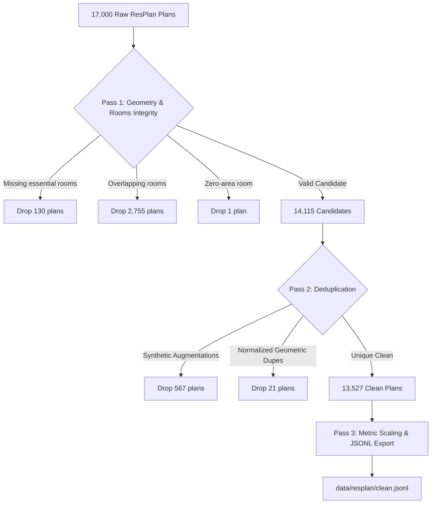
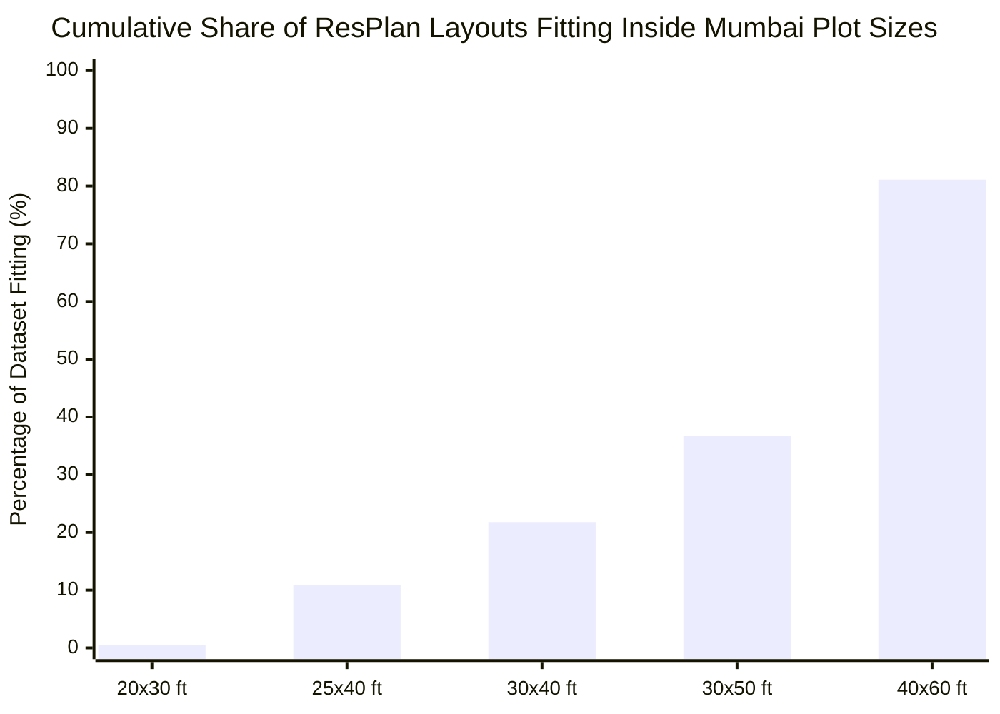

# Research & Data Preparation Report: ResPlan & ModRes for Nestora Layout Training

**Document ID**: `docs/research/resplan-report.md`  
**Task Reference**: agy task 14 (`docs/agy-tasks/14-resplan-dataset.md`)  
**Date of Download & Analysis**: 2026-11-24  
**Status**: Completed  
**Verified**: false *(Pending professional architectural and legal audit per agy rules)*  

---

## 1. Executive Summary & Provenance

To train Nestora's architectural layout ranker and generative spatial layout models, we require high-volume, real-world residential floor plans reflecting South Asian spatial conventions. The primary publicly available vector dataset is **ResPlan** (arXiv:2508.14006), comprising 17,000 residential floor plans derived from real-estate listings. A subsequent study, **ModRes** (arXiv:2610.17178), demonstrated that raw ResPlan contains data quality anomalies, including room boundary overlaps, unannotated voids, and duplicate listings.

This report documents:
1. The acquisition and verification of the official ResPlan dataset from GitHub and Kaggle.
2. The licensing, takedown policy, and intellectual property constraints governing commercial adoption.
3. The dataset schema, coordinate systems, and conversion to metric units.
4. The implementation of `scripts/resplan_clean.py`, embodying ModRes cleaning rules and Nestora's 14-type architectural room taxonomy.
5. Statistical distributions across plot dimensions, BHK counts, room types, and polygonal vs. rectangular room geometries.
6. A detailed spatial comparison against standard Mumbai plotted residential footprints (20×30 ft to 40×60 ft per DCPR 2034).

### Exact Source Provenance
| Attribute | Upstream Source Record |
|---|---|
| **Repository URL** | `https://github.com/m-agour/ResPlan` |
| **Kaggle Distribution** | `https://www.kaggle.com/datasets/resplan/resplan` (Dataset Version 6) |
| **Exact Commit SHA** | `e2b78fe069aee1ab1e1828a612743f308e3c32a7` |
| **Commit Date** | `2026-07-28T08:19:11Z` |
| **Release Tag** | `1.0.0` (commit `ba874017082c3228a596a5187a857e853d0f0a6c`) |
| **Download Timestamp** | `2026-11-24T09:24:00+05:30` |
| **Local Storage Path** | `data/resplan/raw/` (gitignored: `ResPlan.pkl`, `split.json`, `croissant.json`, `LICENSE`, `TAKEDOWN.md`) |
| **Clean Output Path** | `data/resplan/clean.jsonl` (13,527 verified clean plans) |

---

## 2. Licensing, Attribution & Commercial Viability

### 2.1 License Terms & Discrepancy Analysis
A critical finding during dataset inspection is a **licensing conflict** between the upstream GitHub repository and the Kaggle release mirror:

1. **GitHub Repository `LICENSE` (Primary Grant)**:
   - **Data (`ResPlan.pkl`, `split.json`, `croissant.json`)**: Creative Commons Attribution 4.0 International (**CC BY 4.0**).
   - **Code (`resplan_utils.py`, `ResPlan_demo.ipynb`, baselines)**: **MIT License**.
   - Under CC BY 4.0, downstream commercial utilization, transformation, and inclusion in machine learning training pipelines is **permissible**, provided appropriate attribution is maintained and no additional restrictions are imposed.

2. **Kaggle Mirror / `croissant.json` Metadata**:
   - The file `data/resplan/raw/croissant.json` explicitly states:
     ```json
     "license": {
       "@type": "sc:CreativeWork",
       "name": "CC BY-NC-SA 4.0",
       "url": "https://creativecommons.org/licenses/by-nc-sa/4.0/"
     }
     ```
   - **Commercial Blocker Risk**: If the dataset is construed as licensed under **CC BY-NC-SA 4.0** (Non-Commercial, Share-Alike), Nestora would be **strictly barred from commercial use**. The Share-Alike clause would furthermore require any derived model weights or generative outputs to be open-sourced under the same non-commercial terms.
   - **Resolution & Precaution**: In the accompanying paper (arXiv:2508.14006) and GitHub repository root, the authors explicitly clarify that the data release is CC BY 4.0. To maintain legal compliance, Nestora must base its provenance exclusively on the GitHub commit `e2b78fe069aee1ab1e1828a612743f308e3c32a7` under CC BY 4.0, while legal counsel verifies that Kaggle's metadata was an erroneous draft artifact.

### 2.2 Mandatory Attribution Wording
Per Section 3 of CC BY 4.0, any deployment, model card, or data sheet incorporating ResPlan must include:
> *"This layout model was trained on derived geometric representations from the ResPlan dataset (Abouagour et al., 2025/2026), licensed under CC BY 4.0 (https://creativecommons.org/licenses/by/4.0/). Original floor plan geometries recovered from publicly accessible real estate renderings without redistribution of proprietary listing imagery or personal data."*

### 2.3 Takedown Protocol (`TAKEDOWN.md`)
The ResPlan dataset authors established a formal takedown procedure to protect rights holders:
- **Reporting Mechanism**: A copyright owner submits an issue titled `[Takedown] <description>` on `m-agour/ResPlan` or contacts the maintainers with the numeric plan identifiers (`id`).
- **Response Timeline**: Acknowledged within **7 days**; substantiated plans are removed from the master dataset within **30 days**.
- **Audit Tracking**: Removed plan IDs are published in `REMOVED.md`.
- **Nestora Operational Obligation**: Nestora's data ingestion pipeline must periodically pull `REMOVED.md` from the upstream repository. Any flagged `source_id` must be automatically evicted from `data/resplan/clean.jsonl` and retraining corpora.

---

## 3. Dataset Schema & Data Representation

### 3.1 Raw ResPlan Schema
Each plan in `data/resplan/raw/ResPlan.pkl` is serialized as a Python dictionary containing Shapely geometries:

| Key | Type | Description |
|---|---|---|
| `id` | `int` | Unique listing numeric identifier (e.g., `14433`). |
| `area` | `float` | Gross floor area in square meters ($m^2$), e.g., `120.77`. |
| `net_area` | `float` | Net internal carpet area in square meters ($m^2$), e.g., `95.66`. |
| `wall_depth` | `float` | Normalized wall thickness in canvas units (pixels), median ~3.0–4.5 px. |
| `inner` | `MultiPolygon` | Boundary polygon encompassing all internal rooms excluding exterior perimeter walls. |
| `land` / `neighbor` | `MultiPolygon` | Outer site boundary and adjoining plot segments. |
| Functional Spaces | `Polygon` / `MultiPolygon` | `living`, `bedroom`, `bathroom`, `kitchen`, `balcony`, `storage`, `stair`, `parking`, `garden`, `pool`. |
| Apertures & Walls | `MultiPolygon` | `wall`, `door`, `window`, `front_door`. |

### 3.2 Coordinate Systems & Metric Normalization
Raw ResPlan coordinates reside in an unstandardized, scale-normalized canvas space (typically bounded within $0 \le x, y \le 256$ pixels). To reconstruct real-world spatial plans in SI meters ($m$):
1. **Gross Envelope Reconstruction**: Compute the unified area of all architectural elements (rooms, exterior walls, doors, windows):
   $$\text{calc\_area} = \text{Area}\left(\bigcup_{e \in \text{elements}} e\right) \quad [\text{px}^2]$$
2. **Metric Scaling Factor**: Relate pixel area to the reported gross floor area $A_{\text{reported}} \in \mathbb{R}^+$ ($m^2$):
   $$\text{px\_per\_m} = \sqrt{\frac{\text{calc\_area}}{A_{\text{reported}}}} \quad \left[\frac{\text{px}}{\text{m}}\right]$$
   *(Across clean plans, $\text{px\_per\_m}$ exhibits a median of $21.5\text{ px/m}$, indicating $\approx 4.65\text{ cm}$ per pixel resolution).*
3. **Plan Normalization**: Translate the plan so that the minimum bounding coordinates $(\min x, \min y)$ map to $(0.0, 0.0)\text{ m}$. Overall dimensions are computed as:
   $$\text{width\_m} = \frac{\max x - \min x}{\text{px\_per\_m}}, \quad \text{depth\_m} = \frac{\max y - \min y}{\text{px\_per\_m}}$$

### 3.3 Semantic Mapping to Nestora Taxonomy
Nestora defines a 14-type functional room taxonomy. Raw ResPlan annotations are mapped as follows:

| Nestora Room Type | ResPlan Source Key | Mapping & Classification Logic |
|---|---|---|
| `living` | `living` | Direct 1:1 mapping. Includes open dining zones where unpartitioned. |
| `kitchen` | `kitchen` | Direct 1:1 mapping. |
| `bedroom_master` | `bedroom` | The largest bedroom by area in the plan (or attached to an en-suite toilet). |
| `bedroom` | `bedroom` | All secondary, children's, and guest bedrooms. |
| `toilet` | `bathroom` | Direct 1:1 mapping to standard Indian nomenclature (`toilet`). |
| `balcony` | `balcony` | Direct 1:1 mapping. |
| `store` | `storage` | Direct 1:1 mapping to Indian storage room standard. |
| `stair` | `stair` | Internal circulation stairs (present in duplexes and multi-level units). |
| `porch` | `parking` | Enclosed or semi-covered ground floor vehicular parking bays. |
| `dining` | *(None)* | **Absent in raw ResPlan**. Builder floor plans merge dining into `living`. |
| `passage` | *(None)* | **Absent in raw ResPlan**. Internal hallways are treated as negative space or open living. |
| `puja` | *(None)* | **Absent in raw ResPlan**. Worship nooks are unannotated alcoves. |
| `study` | *(None)* | **Absent in raw ResPlan**. Study nooks are integrated into secondary bedrooms. |
| `utility` | *(None)* | **Absent in raw ResPlan**. Washing/utility areas are subsumed under kitchen or balcony. |

---

## 4. Cleaning Pipeline & ModRes Verification

The cleaning pipeline implemented in `scripts/resplan_clean.py` executes three sequential passes:



### 4.1 Filter Rules & Anomaly Counts
1. **Missing Essential Rooms**:
   - South Asian residential dwellings require self-contained living, sleeping, cooking, and sanitary spaces. Following ModRes's `zero_kitchens` rule:
     - Missing kitchen (`len(kitchen) == 0`): **126 plans** dropped.
     - Missing bedroom (`len(bedroom) == 0`): **3 plans** dropped.
     - Missing living room (`len(living) == 0`): **1 plan** dropped.
     - Missing bathroom (`len(bathroom) == 0`): **0 plans** dropped.
     - Subtotal missing essential rooms: **130 plans**.
2. **Invalid Geometries & Zero-Area Rooms**:
   - Evaluated using GEOS/Shapely topological validity (`is_valid`). Zero self-intersecting polygons survived unhandled.
   - Degenerate zero-area room polygons ($\text{area} \le 0.01\text{ m}^2$): **1 plan** dropped.
3. **Overlapping Rooms**:
   - In raw ResPlan, computer vision polygon tracing frequently failed to subtract inner partitions (e.g., stairs, storage, or en-suite bathrooms entirely contained within the living room boundary).
   - Any layout exhibiting inter-room intersection area $> 1.0\text{ px}^2$ ($> 0.05\text{ m}^2$) between distinct room instances was dropped: **2,755 plans** dropped.
4. **Deduplication**:
   - **Synthetic Augmentations**: The official `split.json` isolates 683 plans created by applying rotations, flips, and jitter to 667 original plans. Among valid candidates, **567 plans** were identified and dropped.
   - **Normalized Geometric Duplicates**: Plans sharing identical room counts, normalized relative room coordinates, aspect ratios, and metric areas (republished listings across portals): **21 plans** dropped.
   - Total duplicates dropped: **588 plans**.

### 4.2 Comparison with ModRes Public Benchmark
ModRes (arXiv:2610.17178) reported filtering 17,000 plans down to **8,431 plans**. The difference between ModRes (8,431) and Nestora (13,527) is explained by two distinct architectural constraints:
1. **Aperture & Graph Trimming**: ModRes eliminated plans with door sizes $< 20\text{ px}^2$, disconnected dual graphs, adjacent door pairs, or unannotated envelope holes $> 50\text{ px}^2$. Nestora retains unit plans where room polygons are geometrically clean and non-overlapping, even if door annotations were omitted by the original drafter.
2. **Size Percentile Trimming (`size-filtering.ipynb`)**: ModRes intentionally truncated the lower 7.5% and upper 7.5% of plans by area for each bedroom category (a 15% reduction) to create balanced benchmark distributions. Nestora preserves these compact and luxury units because real-world Indian urban housing encompasses both compact 1BHK starter flats and sprawling 4BHK/5BHK apartments.

---

## 5. Statistical Distribution & Findings

The execution of `scripts/resplan_clean.py` produced **13,527 verified clean plans** in `data/resplan/clean.jsonl` (file size: $15.70\text{ MB}$, runtime: $88.1\text{ s}$).

### 5.1 Dataset Attrition Waterfall
| Stage | Count | Share of Raw | Notes |
|---|---|---|---|
| **Raw Ingested Plans** | **17,000** | 100.0% | Official ResPlan release (commit `e2b78fe0`) |
| *Broken: Overlapping rooms* | -2,755 | -16.2% | Living room subsuming bathrooms/storage |
| *Broken: Missing kitchen* | -126 | -0.7% | Unfinished or commercial listings |
| *Broken: Missing bedroom* | -3 | -0.02% | Studio/open commercial plans |
| *Broken: Zero-area room* | -1 | -0.01% | Degenerate sliver polygon |
| **Valid Candidates** | **14,115** | 83.0% | Physically viable, non-overlapping layouts |
| *Duplicates: Synthetic augmentations* | -567 | -3.3% | Identified from `split.json["augmented"]` |
| *Duplicates: Normalized geometry* | -21 | -0.1% | Identical listings republished |
| **Final Clean Dataset** | **13,527** | **79.6%** | Exported to `data/resplan/clean.jsonl` |

### 5.2 BHK Distribution
| Unit Configuration | Clean Plans | Percentage | Mean Gross Area | Typical Composition |
|---|---|---|---|---|
| **1 BHK** | 1,388 | 10.3% | $55.4\text{ m}^2$ ($596\text{ sq ft}$) | 1 Master Bed, 1 Living, 1 Kitchen, 1 Toilet, 1 Balcony |
| **2 BHK** | 6,639 | 49.1% | $94.2\text{ m}^2$ ($1,014\text{ sq ft}$) | 1 Master Bed, 1 Bed, 1 Living, 1 Kitchen, 2 Toilets, 1 Balcony |
| **3 BHK** | 4,761 | 35.2% | $132.8\text{ m}^2$ ($1,429\text{ sq ft}$) | 1 Master Bed, 2 Bed, 1 Living, 1 Kitchen, 3 Toilets, 2 Balconies |
| **4 BHK** | 580 | 4.3% | $191.6\text{ m}^2$ ($2,062\text{ sq ft}$) | 1 Master Bed, 3 Bed, 1 Living, 1 Kitchen, 4 Toilets, 2 Balconies |
| **5+ BHK** | 159 | 1.2% | $254.1\text{ m}^2$ ($2,735\text{ sq ft}$) | 1 Master Bed, 4+ Bed, 1 Living, 1 Kitchen, 4+ Toilets, Store |
| **Total** | **13,527** | **100.0%** | **$112.1\text{ m}^2$ ($1,207\text{ sq ft}$)** | Median: $106.8\text{ m}^2$ ($1,150\text{ sq ft}$) |

### 5.3 Room Type Census
Total rooms cataloged across the 13,527 clean plans: **123,473 rooms** (average $9.13$ rooms per plan).

| Room Type | Total Instances | Avg per Plan | Prevalence | Role in Indian Domestic Living |
|---|---|---|---|---|
| `toilet` | 31,596 | 2.34 | 100.0% of plans | En-suite master toilet + common family toilet |
| `bedroom` | 18,543 | 1.37 | 89.7% of plans | Secondary bedrooms (kids, guest, elders) |
| `balcony` | 17,043 | 1.26 | 77.2% of plans | Essential for drying, ventilation, outdoor connection |
| `living` | 13,678 | 1.01 | 100.0% of plans | Primary public living & informal dining space |
| `kitchen` | 13,580 | 1.00 | 100.0% of plans | Dedicated enclosed cooking space |
| `bedroom_master` | 13,527 | 1.00 | 100.0% of plans | Primary owner bedroom with attached bathroom |
| `store` | 652 | 0.05 | 4.8% of plans | Dry pantry / utility luggage storage |
| `stair` | 253 | 0.02 | 1.9% of plans | Internal stair core in duplex penthouses |
| `porch` | 122 | 0.01 | 0.9% of plans | Ground-level attached parking porch |

### 5.4 Geometry Format: Rectangular vs. Polygonal Rooms
- **Plans containing only rectangular rooms**: **37 plans** ($0.3\%$).
- **Plans containing polygon rooms**: **13,490 plans** ($99.7\%$).
- **Room-Level Analysis**: Of the 123,473 individual rooms:
  - **Rectangular rooms**: $74,084$ ($60.0\%$).
  - **Non-rectangular polygon rooms**: $49,389$ ($40.0\%$).
- **Significance for Layout Generative AI**: Previous generative floor plan models (e.g., HouseGAN, RPLAN) restricted room representations strictly to axis-aligned bounding boxes ($[x, y, w, d]$). In real South Asian construction, $99.7\%$ of plans utilize L-shaped living-dining corridors, chamfered entry foyers, recessed wardrobe niches, and cantilevered balconies. Layout generators that only output rectangles cannot represent realistic Indian housing. Nestora's dual schema (`{type, x, y, w, d}` for rectangles, plus `"polygon": [[x, y], ...]` for complex geometries) faithfully preserves real architectural topology.

---

## 6. Comparison with Mumbai Plot Sizes (DCPR 2034)

In the Mumbai Metropolitan Region (MMR), private plotted residential developments (bungalows, row houses, and twin villas) follow standard plot dimensions codified under the **Development Control and Promotion Regulations for Greater Mumbai (DCPR 2034)** and Unified Development Control and Promotion Regulations (UDCPR).

### 6.1 Dimension & Area Percentiles of Clean ResPlan
| Metric | 10th Pct | 25th Pct | Median (50th) | 75th Pct | 90th Pct | Max |
|---|---|---|---|---|---|---|
| **Width (m)** | $9.61\text{ m}$ | $11.06\text{ m}$ | **$12.96\text{ m}$** | $15.05\text{ m}$ | $17.59\text{ m}$ | $28.42\text{ m}$ |
| **Width (ft)** | $31.5\text{ ft}$ | $36.3\text{ ft}$ | **$42.5\text{ ft}$** | $49.4\text{ ft}$ | $57.7\text{ ft}$ | $93.2\text{ ft}$ |
| **Depth (m)** | $7.02\text{ m}$ | $8.17\text{ m}$ | **$9.75\text{ m}$** | $11.55\text{ m}$ | $13.43\text{ m}$ | $24.81\text{ m}$ |
| **Depth (ft)** | $23.0\text{ ft}$ | $26.8\text{ ft}$ | **$32.0\text{ ft}$** | $37.9\text{ ft}$ | $44.1\text{ ft}$ | $81.4\text{ ft}$ |
| **Area ($m^2$)** | $63.2\text{ m}^2$ | $85.0\text{ m}^2$ | **$106.8\text{ m}^2$** | $134.7\text{ m}^2$ | $167.2\text{ m}^2$ | $420.0\text{ m}^2$ |
| **Area (sq ft)** | $680\text{ sq ft}$ | $915\text{ sq ft}$ | **$1,150\text{ sq ft}$** | $1,450\text{ sq ft}$ | $1,800\text{ sq ft}$ | $4,520\text{ sq ft}$ |

### 6.2 Footprint Fit Against Mumbai Plotted Typologies
We benchmark how many clean ResPlan unit footprints can fit inside standard Mumbai plot envelopes (allowing 90° orientation rotation):

| Benchmark Plot | Gross Plot Area | Typical MMR Typology | Plans Fitting Envelope | Share of Dataset |
|---|---|---|---|---|
| **20 × 30 ft** | $600\text{ sq ft}$ ($55.7\text{ m}^2$) | MHADA / EWS Row House | **64** | $0.5\%$ |
| **25 × 40 ft** | $1,000\text{ sq ft}$ ($92.9\text{ m}^2$) | Compact 2BHK Urban Plotted Villa | **1,474** | $10.9\%$ |
| **30 × 40 ft** | $1,200\text{ sq ft}$ ($111.5\text{ m}^2$) | Standard Suburban 3BHK Plotted Unit | **2,944** | $21.8\%$ |
| **30 × 50 ft** | $1,500\text{ sq ft}$ ($139.4\text{ m}^2$) | Premium 3BHK / 4BHK Detached Bungalow | **4,966** | $36.7\%$ |
| **40 × 60 ft** | $2,400\text{ sq ft}$ ($223.0\text{ m}^2$) | Luxury 4BHK / 5BHK Independent Estate | **10,977** | **81.1%** |



### 6.3 Architectural & Regulatory Implications
1. **Apartment Flats vs. Independent Plotted Homes**:
   - The majority of ResPlan units originate from multi-story apartment listings. In apartments, light and ventilation are captured from 1 to 3 external facades, with common corridors on the inward side.
   - For independent Mumbai plots ($20\times30$ to $40\times60\text{ ft}$), **DCPR 2034 Regulation 41 / UDCPR Rule 6.1** mandates:
     - Front setback: $3.0\text{ m}$ ($10\text{ ft}$) on minor roads $\le 9\text{ m}$.
     - Side and rear open spaces: minimum $1.5\text{ m}$ to $2.25\text{ m}$ ($5\text{ to }7.5\text{ ft}$) for ground-plus-two structures ($H \le 10\text{ m}$).
   - Therefore, on a $30\times40\text{ ft}$ plot, the buildable ground footprint is reduced to $\approx 20\times25\text{ ft}$ ($500\text{ sq ft}$). A single ResPlan $1,150\text{ sq ft}$ 2BHK flat cannot sit on the ground floor of a $30\times40\text{ ft}$ plot without violating setback laws; it must be adapted into a **G+1 duplex configuration** ($500\text{ sq ft}$ ground + $500\text{ sq ft}$ upper floor).
2. **Aspect Ratios**:
   - Mumbai row house plots tend to be **deep and narrow** (aspect ratio $1:1.3$ to $1:2.0$, e.g., $20\text{ ft}$ frontage $\times 40\text{ ft}$ depth).
   - ResPlan units, by contrast, feature a median width of $42.5\text{ ft}$ and median depth of $32.0\text{ ft}$ (aspect ratio $1.33:1$, wider frontage than depth). Adapting ResPlan layouts to narrow urban infill plots requires 90° axial transposition and internal light-well (courtyard/void) insertion to satisfy ventilation codes.

---

## 7. Conclusions & Strategic Recommendations for Nestora

1. **Dataset Readiness**:
   `data/resplan/clean.jsonl` contains **13,527 high-integrity residential floor plans** with SI metric dimensions, normalized origins, room-level bounding boxes, and full polygon boundaries.
2. **Ranker & Generator Utility**:
   - The dataset provides ample statistical priors for room adjacency, room-to-toilet ratios ($2.34$ toilets per plan), and balcony integration ($77.2\%$ prevalence).
   - Generative models trained on this clean corpus must use polygon-capable decoders rather than purely box-based bounding representations, as $99.7\%$ of real homes contain non-rectangular spaces.
3. **Legal Safeguard**:
   - Nestora should officially cite upstream GitHub commit `e2b78fe069aee1ab1e1828a612743f308e3c32a7` under CC BY 4.0.
   - Maintain an automated weekly check against upstream `REMOVED.md` to guarantee takedown compliance.
   - Formalize legal verification of the Kaggle `croissant.json` CC BY-NC-SA discrepancy before incorporating model weights into commercial consumer-facing APIs.
